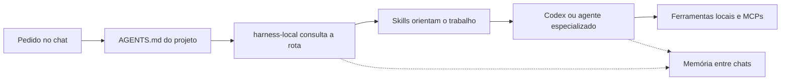

# Harness_Local

O Harness_Local prepara a pasta de um projeto para o Codex retomar decisões de outros chats e escolher skills, agentes e ferramentas para cada tarefa. Abra a raiz desse projeto no Codex Desktop ou na extensão do VS Code.

## Como o Codex escolhe uma skill

Faça o pedido normalmente no chat do projeto. O `AGENTS.md` orienta o Codex a usar `harness-local`, que consulta as rotas geradas para aquele perfil. Cada rota descreve um tipo de tarefa, indica os recursos que podem ajudar e traz uma alternativa para quando faltam dependências.



| Recurso | Papel no fluxo |
| --- | --- |
| Skill | Dá ao Codex um procedimento. Por exemplo, `design-brief` organiza o problema, o público e os objetivos, que orientam as escolhas de `information-architecture` sobre navegação e hierarquia. |
| Agente | Recebe um objetivo e devolve um resultado que a próxima etapa pode usar. O Planner do Playwright entrega um plano com cenário, seed e caminho do teste para o Generator. |
| MCP | Expõe operações ao Codex e aos agentes. `harness_local` consulta e grava notas, `ast_grep` procura padrões estruturais no código e `playwright-test` opera o navegador e executa testes. |
| Plugin | Disponibiliza skills vindas do cliente. Quando o ECC está instalado, o Codex pode consultar uma skill da stack para complementar a rota de código. |
| Comando local | Executa uma tarefa no terminal. Docling extrai dados de documentos e RTK resume a saída de consultas exploratórias. |

O Codex escolhe as instruções conforme o pedido e os recursos do projeto. As chamadas de ferramentas seguem as permissões do cliente. `revisar-escrita` orienta a redação das entregas em todas as rotas. Peça o modo telegráfico quando quiser usar `caveman`.

### Exemplo de interface com teste de ponta a ponta

> Adicione um filtro de status à tela de pedidos e cubra o fluxo com um teste E2E.

1. Pela rota `interface`, o Codex examina a tela existente e usa `frontend-design` ou `design-taste-frontend` para orientar o desenho do filtro. O Codex reaproveita os componentes e tokens do projeto que já servem ao fluxo. No perfil completo, `ui-ux-pro-max` pode ajudar a consultar padrões de UI e `impeccable-review` a revisar a tela renderizada.
2. Pela rota `codigo`, `ponytail` orienta a implementar a menor mudança que cubra o comportamento. Uma inspeção visual pode usar `agent-browser` ou outro navegador disponível.
3. Com o Playwright configurado, a rota `e2e` orienta o **Planner** a explorar a tela e registrar o cenário, o resultado esperado, a seed (teste de partida) e o destino do teste. O **Generator** usa esse plano para percorrer o fluxo, escrever o teste e executá-lo com `playwright-test`.
4. Se o teste falhar e precisar de reparo, o **Healer** recebe o caminho, a asserção e o comportamento esperado. Ele reproduz a falha, distingue um defeito da aplicação de um problema no teste e reexecuta a verificação após uma correção.

### Outras combinações

| Pedido no chat | Rota | Como os recursos se combinam |
| --- | --- | --- |
| “Planeje a navegação do portal.” | `planejar-design` | `design-brief` registra as necessidades. `information-architecture` usa o briefing para organizar páginas, rótulos e fluxos. Uma entrevista solicitada pelo usuário usa `grill-me` com `grilling`. |
| “Corrija a paginação desta API.” | `codigo` | `source-driven-development` confirma o contrato que a mudança precisa respeitar. `ast_grep`, quando disponível, localiza chamadas e imports relevantes. `ponytail` orienta a correção e a verificação. |
| “Mapeie os módulos afetados por esta mudança.” | `legado` | `cartographer` produz o mapa do projeto. `graphify` ajuda a seguir chamadas e dependências. RepoWise, quando ativado para um repositório indexado, acrescenta evidência do histórico Git. |
| “Compare as tabelas destes PDFs.” | `dados` | Docling extrai as tabelas. `jupyter-notebook` organiza a limpeza, os cálculos e a comparação de forma reproduzível. |
| “Monte um esqueleto para esta prova discursiva.” | `estudos` | `redacao-e-estudo-de-caso` parte do enunciado e dos critérios da banca. `revisar-escrita` ajuda a revisar clareza e precisão. |
| “Encontre uma skill para revisar acessibilidade.” | `gestao` | `find-skills` procura opções. Se o pedido incluir a instalação, o fluxo confirma a origem, revisa a cópia com SkillSpector e usa `manage-skills` para organizar a biblioteca. |

O catálogo registra as rotas completas, a origem dos componentes e suas dependências. [Catálogo](catalog.json)

## Como o contexto passa de um chat para outro

Ao receber um pedido como “Retome a paginação”, `harness-local` usa `memory_recall` para buscar até cinco notas relevantes. O Codex confere o que encontrou com o código e o pedido atual. Uma decisão reutilizável ou passagem de trabalho pode ser registrada por `memory_save` com uma chave, um resumo e a origem. Por exemplo, uma nota pode guardar o tamanho de página escolhido, o teste que passou e o que falta verificar.

Por padrão, os perfis preparados a partir do mesmo checkout usam o banco SQLite em `.harness-local/state/memoria.sqlite3` desse checkout. A busca combina as notas pessoais e as do projeto indicado. Em Git, o escopo é o caminho retornado por `git rev-parse --path-format=absolute --git-common-dir`. Duas worktrees do mesmo repositório compartilham as notas de projeto quando usam o mesmo banco. Em outras pastas, o escopo é a raiz absoluta. Passe `--database` ao preparar o perfil para escolher outro banco.

`--activity` acrescenta hooks opcionais. Após a revisão no cliente, eles registram caminhos editados e resultados de verificações reconhecidas e podem fornecer um resumo recente ao abrir ou retomar uma sessão. Use `memory_save` para preservar o motivo de uma decisão e o próximo passo. Guarde na memória apenas o necessário para retomar o trabalho e mantenha credenciais e transcrições fora das notas. [Hooks do Codex](https://learn.chatgpt.com/docs/hooks)

## Começar no Windows

Você precisa de Python 3.11 ou mais recente. Com seu cliente Codex instalado, prepare o perfil base no PowerShell.

```powershell
git clone https://github.com/VictorCoutinhoz/Harness_Local.git
cd Harness_Local
python harness.py doctor --strict
python harness.py prepare ./.harness-local/workspaces/base
```

Abra a pasta `.harness-local/workspaces/base` como projeto no Codex e confirme a confiança da pasta para carregar a configuração MCP. Para aplicar o perfil a um projeto existente, passe a raiz desse projeto a `prepare`. Mantenha o checkout do Harness_Local acessível porque a configuração referencia os scripts nele. [Configuração por projeto no Codex](https://learn.chatgpt.com/docs/config-file/config-advanced)

| Perfil | Skills do projeto | Agentes do perfil | MCPs |
| --- | --- | --- | --- |
| Base | 17, incluídas no repositório | — | Memória |
| Completo | 26, incluindo cópias revisadas fornecidas localmente | Planner, Generator e Healer | Memória, ast-grep e Playwright. RepoWise opcional por repositório indexado. |

`prepare` grava as skills em `.agents/skills/`, os perfis dos agentes em `.codex/agents/` quando disponíveis e os MCPs em `.codex/config.toml`. Também adiciona um bloco de instruções ao `AGENTS.md` e gera as rotas em `.agents/skills/harness-local/references/routes.md`. O bloco gerado no `.gitignore` cobre os arquivos do perfil e os diretórios de estado dentro do projeto.

Ao rodar `prepare` novamente com as mesmas entradas, os arquivos já preparados são reaproveitados. Se houver um arquivo conflitante, o comando aponta o caminho antes de escrever. [Agentes do Codex](https://learn.chatgpt.com/docs/agent-configuration/subagents) · [MCP no Codex](https://learn.chatgpt.com/docs/extend/mcp)

### Perfil completo

Aponte para um diretório com os runtimes instalados e outro com as cópias revisadas das skills extras. Em uma instalação nova, `prepare-runtime` copia os launchers do projeto. O guia descreve os caminhos onde você instala as dependências. [Guia do perfil completo](docs/perfil-completo.md)

```powershell
$runtime = 'D:/ferramentas/HarnessLocal'
$skills = 'D:/ferramentas/skills-revisadas'
python harness.py doctor --profile completo --runtime-root $runtime --skills-root $skills --strict
python harness.py prepare ./.harness-local/workspaces/completo --profile completo --runtime-root $runtime --skills-root $skills
```

O `doctor` aponta os caminhos e dependências ausentes. Os testes nativos no Windows verificaram a memória, o ast-grep e um cenário de navegador no Codex Desktop e na extensão do VS Code. [Resultados da verificação](docs/validacao.md)

## Consultar as rotas e verificar o projeto

```powershell
python harness.py inventory
python harness.py route interface
python harness.py route e2e
python -m unittest discover -s tests -v
```

`inventory` lista os componentes do catálogo. `route` imprime a orientação, os recursos do perfil selecionado e a alternativa prevista para dependências ausentes. Passe `--profile completo` com `--runtime-root` e `--skills-root` para consultar as opções do perfil completo.

[Origens e licenças](THIRD_PARTY.md) · [Preparação para publicação](docs/publicacao.md)
