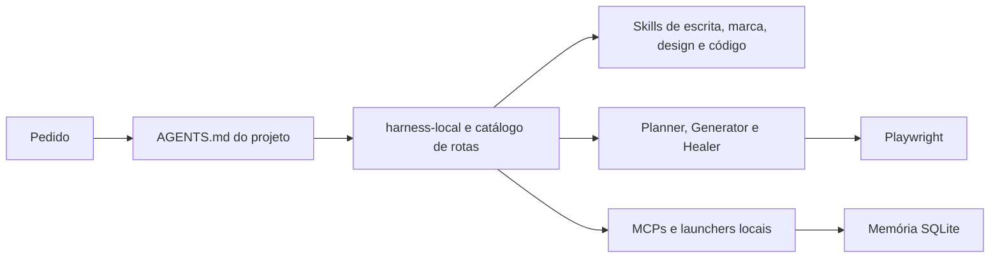

# Harness_Local

Perfil local do Codex para retomar projetos, escolher skills pelo pedido e ligar agentes às ferramentas que verificam o trabalho. O catálogo registra os recursos disponíveis, a origem e as dependências de cada integração.



## Começar

Use Python 3.11 ou mais recente e um cliente Codex local. Em PowerShell, na raiz do checkout:

```powershell
python harness.py doctor --strict
python harness.py prepare ./.harness-local/workspaces/base
```

Abra a pasta gerada no Codex e confirme a confiança daquele projeto para carregar a configuração MCP. O perfil base traz 17 skills e o MCP de memória. O mesmo checkout pode preparar vários projetos. Por padrão, eles usam um banco local comum, com notas separadas pelo diretório Git comum ou pela raiz absoluta do projeto. Use `--database` para escolher outro banco.

Para captura automática de caminhos editados e resultados de verificações, adicione `--activity` à preparação. O cliente apresenta os hooks para revisão antes de executá-los. [Configuração por projeto](https://learn.chatgpt.com/docs/config-file/config-advanced) · [Hooks do Codex](https://learn.chatgpt.com/docs/hooks)

## Perfil completo no Windows

Use uma instalação local compatível de runtimes e um diretório com as cópias revisadas das skills extras.

```powershell
$runtime = 'D:/ferramentas/HarnessLocal'
$skills = 'D:/ferramentas/skills-revisadas'
python harness.py doctor --profile completo --runtime-root $runtime --skills-root $skills --strict
python harness.py prepare ./.harness-local/workspaces/completo --profile completo --runtime-root $runtime --skills-root $skills
```

O perfil liga ast-grep, Playwright e os três agentes de teste. Use RepoWise por repositório já indexado. O comando `doctor` aponta o caminho que falta quando um módulo está ausente. Para a montagem local e os critérios de verificação das dependências, consulte [Perfil completo](docs/perfil-completo.md).

O preparo grava arquivos no projeto escolhido. Uma reexecução com as mesmas entradas é idempotente. Quando um arquivo já existe ou foi editado fora do fluxo de preparação, o comando indica o conflito antes de escrever.

## Consultar e testar

```powershell
python harness.py inventory
python harness.py route e2e
python -m unittest discover -s tests -v
```

`catalog.json` é a fonte das rotas e dependências. Bancos, configurações específicas da máquina e cópias locais importadas ficam ignorados pelo Git. Os agentes usam o escopo do projeto e as permissões do cliente. [Agentes do Codex](https://learn.chatgpt.com/docs/agent-configuration/subagents) · [MCP no Codex](https://learn.chatgpt.com/docs/extend/mcp)

[Verificação nativa](docs/validacao.md)

[Origens e licenças](THIRD_PARTY.md) · [Preparação para publicação](docs/publicacao.md)
